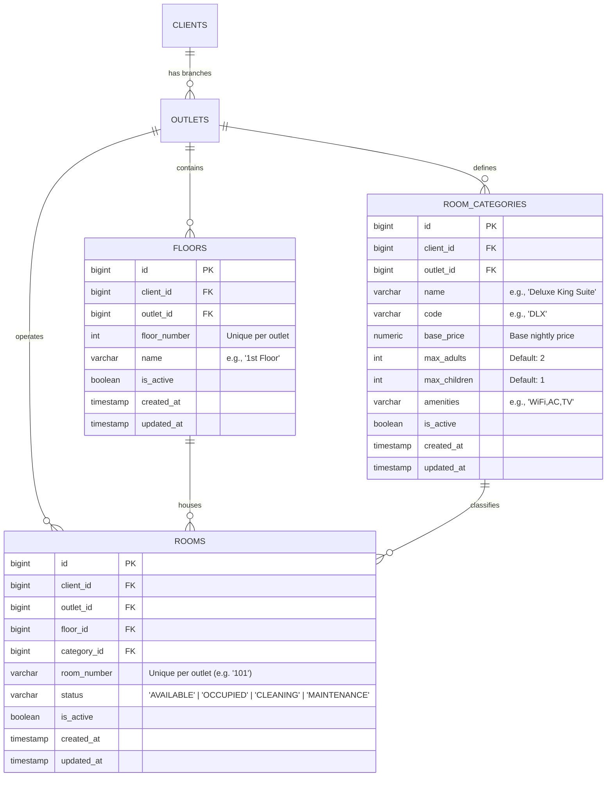

# 🏨 DeskFlow PMS — Floor & Room Section System Design & DB Architecture

This document provides the complete, production-grade system design, database schema, and operational rules for the **Floors, Room Categories, and Rooms** module of DeskFlow PMS.

---

## 1. Architectural Scope & Multi-Tenant Isolation

DeskFlow is a multi-tenant Hotel Property Management System (PMS) where:
- A parent organization (**`Client`**) owns one or more hotel branches (**`Outlet`**).
- All physical units (**`Floor`**, **`RoomCategory`**, and **`Room`**) are strictly partitioned by `outlet_id` and `client_id`.
- The system focuses exclusively on core hotel inventory: **Floors**, **Room Categories (Types/Pricing)**, and **Rooms**.

---

## 2. Entity Relationship Diagram (ERD)



---

## 3. PostgreSQL Database Schema (DDL)

### 3.1. `floors` Table
Represents physical building floors within an outlet.

```sql
CREATE TABLE floors (
    id BIGSERIAL PRIMARY KEY,
    client_id BIGINT NOT NULL REFERENCES clients(id) ON DELETE CASCADE,
    outlet_id BIGINT NOT NULL REFERENCES outlets(id) ON DELETE CASCADE,
    floor_number INT NOT NULL,
    name VARCHAR(100) NOT NULL,
    is_active BOOLEAN NOT NULL DEFAULT TRUE,
    created_at TIMESTAMPTZ NOT NULL DEFAULT NOW(),
    updated_at TIMESTAMPTZ NOT NULL DEFAULT NOW(),

    -- Enforce unique floor numbers per outlet
    CONSTRAINT uq_floor_outlet_number UNIQUE (outlet_id, floor_number)
);

CREATE INDEX ix_floors_outlet_id ON floors(outlet_id);
CREATE INDEX ix_floors_client_id ON floors(client_id);
```

### 3.2. `room_categories` Table
Defines pricing tiers, capacity limits, and amenity catalogs.

```sql
CREATE TABLE room_categories (
    id BIGSERIAL PRIMARY KEY,
    client_id BIGINT NOT NULL REFERENCES clients(id) ON DELETE CASCADE,
    outlet_id BIGINT NOT NULL REFERENCES outlets(id) ON DELETE CASCADE,
    name VARCHAR(100) NOT NULL,
    code VARCHAR(20) NULL,
    base_price NUMERIC(10, 2) NOT NULL,
    max_adults INT NOT NULL DEFAULT 2,
    max_children INT NOT NULL DEFAULT 1,
    amenities VARCHAR(500) NULL, -- CSV: e.g., "WiFi,AC,Mini Bar,Balcony"
    is_active BOOLEAN NOT NULL DEFAULT TRUE,
    created_at TIMESTAMPTZ NOT NULL DEFAULT NOW(),
    updated_at TIMESTAMPTZ NOT NULL DEFAULT NOW(),

    -- Unique category name per outlet
    CONSTRAINT uq_category_outlet_name UNIQUE (outlet_id, name)
);

CREATE INDEX ix_room_categories_outlet_id ON room_categories(outlet_id);
CREATE INDEX ix_room_categories_client_id ON room_categories(client_id);
```

### 3.3. `rooms` Table
The concrete sellable room units situated on a floor and classified by a category.

```sql
CREATE TABLE rooms (
    id BIGSERIAL PRIMARY KEY,
    client_id BIGINT NOT NULL REFERENCES clients(id) ON DELETE CASCADE,
    outlet_id BIGINT NOT NULL REFERENCES outlets(id) ON DELETE CASCADE,
    floor_id BIGINT NOT NULL REFERENCES floors(id) ON DELETE RESTRICT,
    category_id BIGINT NOT NULL REFERENCES room_categories(id) ON DELETE RESTRICT,
    
    room_number VARCHAR(50) NOT NULL,
    status VARCHAR(50) NOT NULL DEFAULT 'AVAILABLE',
    is_active BOOLEAN NOT NULL DEFAULT TRUE,
    created_at TIMESTAMPTZ NOT NULL DEFAULT NOW(),
    updated_at TIMESTAMPTZ NOT NULL DEFAULT NOW(),

    -- Enforce unique room number per outlet
    CONSTRAINT uq_room_outlet_number UNIQUE (outlet_id, room_number),
    
    -- Status validation constraint
    CONSTRAINT chk_room_status CHECK (
        status IN ('AVAILABLE', 'OCCUPIED', 'CLEANING', 'MAINTENANCE')
    )
);

CREATE INDEX ix_rooms_outlet_id ON rooms(outlet_id);
CREATE INDEX ix_rooms_floor_id ON rooms(floor_id);
CREATE INDEX ix_rooms_category_id ON rooms(category_id);
CREATE INDEX ix_rooms_client_id ON rooms(client_id);
CREATE INDEX ix_rooms_status ON rooms(outlet_id, status);
```

---

## 4. SQLAlchemy 2.0 ORM Implementation

These models reside in `app/models/`:

### [`app/models/floor.py`](file:///d:/HRM/HRM-backend/app/models/floor.py)
```python
from sqlalchemy.orm import Mapped, mapped_column, relationship
from sqlalchemy import String, Boolean, BigInteger, Integer, ForeignKey, UniqueConstraint
from typing import List, TYPE_CHECKING
from app.db.base import Base

if TYPE_CHECKING:
    from app.models.room import Room

class Floor(Base):
    __tablename__ = 'floors'

    id: Mapped[int] = mapped_column(BigInteger, primary_key=True, autoincrement=True)
    client_id: Mapped[int] = mapped_column(BigInteger, ForeignKey('clients.id', ondelete='CASCADE'), nullable=False, index=True)
    outlet_id: Mapped[int] = mapped_column(BigInteger, ForeignKey('outlets.id', ondelete='CASCADE'), nullable=False, index=True)
    
    floor_number: Mapped[int] = mapped_column(Integer, nullable=False)
    name: Mapped[str] = mapped_column(String(100), nullable=False)
    is_active: Mapped[bool] = mapped_column(Boolean, default=True, nullable=False)

    rooms: Mapped[List['Room']] = relationship('Room', back_populates='floor', cascade='all, delete-orphan')

    __table_args__ = (
        UniqueConstraint('outlet_id', 'floor_number', name='uq_floor_outlet_number'),
    )
```

### [`app/models/room_category.py`](file:///d:/HRM/HRM-backend/app/models/room_category.py)
```python
from sqlalchemy.orm import Mapped, mapped_column, relationship
from sqlalchemy import String, Boolean, BigInteger, Integer, Numeric, ForeignKey, UniqueConstraint
from typing import List, Optional, TYPE_CHECKING
from decimal import Decimal
from app.db.base import Base

if TYPE_CHECKING:
    from app.models.room import Room

class RoomCategory(Base):
    __tablename__ = 'room_categories'

    id: Mapped[int] = mapped_column(BigInteger, primary_key=True, autoincrement=True)
    client_id: Mapped[int] = mapped_column(BigInteger, ForeignKey('clients.id', ondelete='CASCADE'), nullable=False, index=True)
    outlet_id: Mapped[int] = mapped_column(BigInteger, ForeignKey('outlets.id', ondelete='CASCADE'), nullable=False, index=True)
    
    name: Mapped[str] = mapped_column(String(100), nullable=False)
    code: Mapped[Optional[str]] = mapped_column(String(20), nullable=True)
    base_price: Mapped[Decimal] = mapped_column(Numeric(10, 2), nullable=False)
    max_adults: Mapped[int] = mapped_column(Integer, default=2, nullable=False)
    max_children: Mapped[int] = mapped_column(Integer, default=1, nullable=False)
    amenities: Mapped[Optional[str]] = mapped_column(String(500), nullable=True)
    is_active: Mapped[bool] = mapped_column(Boolean, default=True, nullable=False)

    rooms: Mapped[List['Room']] = relationship('Room', back_populates='category', cascade='all, delete-orphan')

    __table_args__ = (
        UniqueConstraint('outlet_id', 'name', name='uq_category_outlet_name'),
    )
```

### [`app/models/room.py`](file:///d:/HRM/HRM-backend/app/models/room.py)
```python
from sqlalchemy.orm import Mapped, mapped_column, relationship
from sqlalchemy import String, Boolean, BigInteger, ForeignKey, UniqueConstraint
from typing import TYPE_CHECKING
from app.db.base import Base

if TYPE_CHECKING:
    from app.models.floor import Floor
    from app.models.room_category import RoomCategory

class Room(Base):
    __tablename__ = 'rooms'

    id: Mapped[int] = mapped_column(BigInteger, primary_key=True, autoincrement=True)
    client_id: Mapped[int] = mapped_column(BigInteger, ForeignKey('clients.id', ondelete='CASCADE'), nullable=False, index=True)
    outlet_id: Mapped[int] = mapped_column(BigInteger, ForeignKey('outlets.id', ondelete='CASCADE'), nullable=False, index=True)
    floor_id: Mapped[int] = mapped_column(BigInteger, ForeignKey('floors.id', ondelete='RESTRICT'), nullable=False, index=True)
    category_id: Mapped[int] = mapped_column(BigInteger, ForeignKey('room_categories.id', ondelete='RESTRICT'), nullable=False, index=True)
    
    room_number: Mapped[str] = mapped_column(String(50), nullable=False)
    status: Mapped[str] = mapped_column(String(50), default='AVAILABLE', nullable=False)
    is_active: Mapped[bool] = mapped_column(Boolean, default=True, nullable=False)

    floor: Mapped['Floor'] = relationship('Floor', back_populates='rooms')
    category: Mapped['RoomCategory'] = relationship('RoomCategory', back_populates='rooms')

    __table_args__ = (
        UniqueConstraint('outlet_id', 'room_number', name='uq_room_outlet_number'),
    )
```

---

## 5. GraphQL API Operations

### Queries (`app/graphql/queries/room_queries.py`)
| Query | Description |
| :--- | :--- |
| `floors(isActive: Boolean = true)` | Lists all floors with active room count for the active outlet. |
| `roomCategories(isActive: Boolean = true)` | Lists room categories with pricing, max guests, and amenities. |
| `rooms(floorId, categoryId, status, isActive)` | Lists filtered rooms. |
| `hotelLayout` | **Single-query master endpoint:** Returns all floors nested with their rooms, category details, pricing, and live room status statistics (`total_rooms`, `available_rooms`, `occupied_rooms`, `cleaning_rooms`, `maintenance_rooms`). |

### Mutations (`app/graphql/mutations/room_mutations.py`)
| Mutation | Description |
| :--- | :--- |
| `createFloor(input: CreateFloorInput)` | Creates a new floor in the active outlet. |
| `updateFloor(id: Int, input: UpdateFloorInput)` | Modifies floor name, number, or active state. |
| `deleteFloor(id: Int)` | Soft-deletes a floor (blocked if active rooms exist). |
| `createRoomCategory(input: CreateRoomCategoryInput)` | Defines a new category, base price, and capacity. |
| `updateRoomCategory(id: Int, input: UpdateRoomCategoryInput)` | Updates pricing, name, code, or amenities. |
| `deleteRoomCategory(id: Int)` | Soft-deletes a category (blocked if rooms belong to it). |
| `createRoom(input: CreateRoomInput)` | Adds a room to a designated floor and category. |
| `updateRoom(id: Int, input: UpdateRoomInput)` | Updates room number, floor assignment, or category. |
| `updateRoomStatus(roomId: Int, status: RoomStatusEnum)` | Updates live status (`AVAILABLE`, `OCCUPIED`, `CLEANING`, `MAINTENANCE`). |
| `deleteRoom(id: Int)` | Soft-deletes a room (blocked if room is `OCCUPIED`). |

---

## 6. Business Invariants & Integrity Constraints

1. **Multi-Property Number Reusability:**
   - Room numbers and floor numbers are scoped strictly to `outlet_id`. Branch A and Branch B can both have Room "101" without collision.
2. **Deletion Safeguards (`ON DELETE RESTRICT`):**
   - Cannot delete a `Floor` while rooms reside on it.
   - Cannot delete a `RoomCategory` while rooms reference it.
   - Cannot delete or deactivate a `Room` while its status is `OCCUPIED`.
3. **Optimized Layout Queries:**
   - The Front-Desk tape chart fetches the entire hotel structure via `hotelLayout` in **1 single query**, eliminating N+1 database roundtrips.

---

## 7. Example Demo Data

Here is a realistic hotel configuration for **"Grand Palace Hotel"** at **Outlet ID 102 ("Kolhapur Branch")**.

### 7.1. Visual Data Tables

#### `floors` (4 Floors)
| id | client_id | outlet_id | floor_number | name | is_active |
| :--- | :--- | :--- | :--- | :--- | :--- |
| **1** | 1 | 102 | 1 | Ground Floor — Lobby & Garden Suites | TRUE |
| **2** | 1 | 102 | 2 | First Floor — Executive Wing | TRUE |
| **3** | 1 | 102 | 3 | Second Floor — Premium Suites | TRUE |
| **4** | 1 | 102 | 4 | Third Floor — Presidential Penthouse | TRUE |

#### `room_categories` (4 Tiers)
| id | client_id | outlet_id | name | code | base_price | max_adults | max_children | amenities |
| :--- | :--- | :--- | :--- | :--- | :--- | :--- | :--- | :--- |
| **10** | 1 | 102 | Standard Double | `STD-DBL` | ₹2,500.00 | 2 | 1 | WiFi, AC, TV, Electric Kettle |
| **11** | 1 | 102 | Deluxe King | `DLX-KNG` | ₹4,200.00 | 2 | 2 | High-speed WiFi, Split AC, 55" Smart TV, Mini Bar, Balcony |
| **12** | 1 | 102 | Executive Suite | `EXE-STE` | ₹6,800.00 | 3 | 2 | High-speed WiFi, Central AC, Living Room, Jacuzzi, Work Desk |
| **13** | 1 | 102 | Presidential Suite | `PRS-STE` | ₹14,500.00 | 4 | 2 | Private Butler, Panoramic View, Dining Area, Jacuzzi, Private Terrace |

#### `rooms` (12 Rooms Across Floors)
| id | outlet_id | floor_id | category_id | room_number | status | Description |
| :--- | :--- | :--- | :--- | :--- | :--- | :--- |
| **101** | 102 | 1 (Ground) | 10 (Standard Double) | **101** | `AVAILABLE` | Ready for check-in |
| **102** | 102 | 1 (Ground) | 10 (Standard Double) | **102** | `OCCUPIED` | Guest in-house |
| **103** | 102 | 1 (Ground) | 11 (Deluxe King) | **103** | `CLEANING` | Turnaround in progress |
| **104** | 102 | 1 (Ground) | 11 (Deluxe King) | **104** | `AVAILABLE` | Ready for check-in |
| **201** | 102 | 2 (First) | 11 (Deluxe King) | **201** | `OCCUPIED` | Guest in-house |
| **202** | 102 | 2 (First) | 11 (Deluxe King) | **202** | `AVAILABLE` | Ready for check-in |
| **203** | 102 | 2 (First) | 12 (Executive Suite) | **203** | `AVAILABLE` | Ready for check-in |
| **204** | 102 | 2 (First) | 12 (Executive Suite) | **204** | `MAINTENANCE` | AC servicing scheduled |
| **301** | 102 | 3 (Second) | 12 (Executive Suite) | **301** | `OCCUPIED` | Guest in-house |
| **302** | 102 | 3 (Second) | 12 (Executive Suite) | **302** | `AVAILABLE` | Ready for check-in |
| **303** | 102 | 3 (Second) | 12 (Executive Suite) | **303** | `AVAILABLE` | Ready for check-in |
| **401** | 102 | 4 (Third) | 13 (Presidential Suite)| **401** | `AVAILABLE` | Ready for VIP check-in |

---

### 7.2. SQL Seed Script (PostgreSQL INSERT Statements)

```sql
-- 1. Insert Floors for Outlet 102 (Kolhapur)
INSERT INTO floors (id, client_id, outlet_id, floor_number, name, is_active) VALUES
(1, 1, 102, 1, 'Ground Floor — Lobby & Garden Suites', true),
(2, 1, 102, 2, 'First Floor — Executive Wing', true),
(3, 1, 102, 3, 'Second Floor — Premium Suites', true),
(4, 1, 102, 4, 'Third Floor — Presidential Penthouse', true);

-- 2. Insert Room Categories with Pricing & Capacity
INSERT INTO room_categories (id, client_id, outlet_id, name, code, base_price, max_adults, max_children, amenities, is_active) VALUES
(10, 1, 102, 'Standard Double', 'STD-DBL', 2500.00, 2, 1, 'WiFi, AC, TV, Electric Kettle', true),
(11, 1, 102, 'Deluxe King', 'DLX-KNG', 4200.00, 2, 2, 'High-speed WiFi, Split AC, 55-inch Smart TV, Mini Bar, Balcony', true),
(12, 1, 102, 'Executive Suite', 'EXE-STE', 6800.00, 3, 2, 'High-speed WiFi, Central AC, Living Room, Jacuzzi, Work Desk', true),
(13, 1, 102, 'Presidential Suite', 'PRS-STE', 14500.00, 4, 2, 'Private Butler, Panoramic View, Dining Area, Jacuzzi, Private Terrace', true);

-- 3. Insert Concrete Rooms
INSERT INTO rooms (id, client_id, outlet_id, floor_id, category_id, room_number, status, is_active) VALUES
-- Floor 1
(101, 1, 102, 1, 10, '101', 'AVAILABLE', true),
(102, 1, 102, 1, 10, '102', 'OCCUPIED', true),
(103, 1, 102, 1, 11, '103', 'CLEANING', true),
(104, 1, 102, 1, 11, '104', 'AVAILABLE', true),

-- Floor 2
(201, 1, 102, 2, 11, '201', 'OCCUPIED', true),
(202, 1, 102, 2, 11, '202', 'AVAILABLE', true),
(203, 1, 102, 2, 12, '203', 'AVAILABLE', true),
(204, 1, 102, 2, 12, '204', 'MAINTENANCE', true),

-- Floor 3
(301, 1, 102, 3, 12, '301', 'OCCUPIED', true),
(302, 1, 102, 3, 12, '302', 'AVAILABLE', true),
(303, 1, 102, 3, 12, '303', 'AVAILABLE', true),

-- Floor 4
(401, 1, 102, 4, 13, '401', 'AVAILABLE', true);
```

---

### 7.3. What the Frontend Receives (`hotelLayout` GraphQL Response)

When the frontend queries `hotelLayout`, the backend returns this exact JSON payload in **one single roundtrip**:

```json
{
  "data": {
    "hotelLayout": {
      "status": "success",
      "totalFloors": 4,
      "totalRooms": 12,
      "availableRooms": 7,
      "occupiedRooms": 3,
      "cleaningRooms": 1,
      "maintenanceRooms": 1,
      "floors": [
        {
          "id": 1,
          "floorNumber": 1,
          "name": "Ground Floor — Lobby & Garden Suites",
          "roomCount": 4,
          "rooms": [
            { "id": 101, "roomNumber": "101", "status": "AVAILABLE", "categoryName": "Standard Double", "basePrice": 2500.0 },
            { "id": 102, "roomNumber": "102", "status": "OCCUPIED", "categoryName": "Standard Double", "basePrice": 2500.0 },
            { "id": 103, "roomNumber": "103", "status": "CLEANING", "categoryName": "Deluxe King", "basePrice": 4200.0 },
            { "id": 104, "roomNumber": "104", "status": "AVAILABLE", "categoryName": "Deluxe King", "basePrice": 4200.0 }
          ]
        },
        {
          "id": 2,
          "floorNumber": 2,
          "name": "First Floor — Executive Wing",
          "roomCount": 4,
          "rooms": [
            { "id": 201, "roomNumber": "201", "status": "OCCUPIED", "categoryName": "Deluxe King", "basePrice": 4200.0 },
            { "id": 202, "roomNumber": "202", "status": "AVAILABLE", "categoryName": "Deluxe King", "basePrice": 4200.0 },
            { "id": 203, "roomNumber": "203", "status": "AVAILABLE", "categoryName": "Executive Suite", "basePrice": 6800.0 },
            { "id": 204, "roomNumber": "204", "status": "MAINTENANCE", "categoryName": "Executive Suite", "basePrice": 6800.0 }
          ]
        },
        {
          "id": 3,
          "floorNumber": 3,
          "name": "Second Floor — Premium Suites",
          "roomCount": 3,
          "rooms": [
            { "id": 301, "roomNumber": "301", "status": "OCCUPIED", "categoryName": "Executive Suite", "basePrice": 6800.0 },
            { "id": 302, "roomNumber": "302", "status": "AVAILABLE", "categoryName": "Executive Suite", "basePrice": 6800.0 },
            { "id": 303, "roomNumber": "303", "status": "AVAILABLE", "categoryName": "Executive Suite", "basePrice": 6800.0 }
          ]
        },
        {
          "id": 4,
          "floorNumber": 4,
          "name": "Third Floor — Presidential Penthouse",
          "roomCount": 1,
          "rooms": [
            { "id": 401, "roomNumber": "401", "status": "AVAILABLE", "categoryName": "Presidential Suite", "basePrice": 14500.0 }
          ]
        }
      ]
    }
  }
}
```
